# 03 · Dataflow do workflow granular

Meta G4a. Neste documento estão os diagramas em Mermaid, com atividades, arquivos e dependências, e o esboço do `workflow.yaml` do AkôFlow. Os contratos das atividades estão em [02 §2](02-desenho-granular.md#2-as-atividades-atômicas).

**Como os diagramas foram feitos.** O geral foi escrito à mão. O expandido do Zika-21 e o YAML saíram do **mesmo** script de modelo (anexo A), que também calcula a largura e o caminho crítico de [02 §4](02-desenho-granular.md#4-análise-de-paralelismo). Assim, diagrama, YAML e números não têm como divergir. A sintaxe Mermaid **não foi validada por um renderizador** nesta máquina (`mmdc` não está instalado) [não testado].

Convenções:

- **retângulo** = atividade, ou uma família de ativações;
- **paralelogramo** = arquivo ou conjunto de arquivos;
- **borda tracejada** = ativação que falha por construção no Zika-21: as 4 árvores básicas do braço `mafft` dão `SemSitioComparavel` (D28) e terminam em `tentado_e_falhou`, sem árvore.

## 1. Dataflow geral (qualquer configuração)

`A` = número de alinhadores (`tree_config.aligners`); `M` = métodos não ignorados; as famílias `×A` e `×A·M` se expandem por configuração. Nos rótulos, `{s}` é o stem do FASTA, `{alg}` o alinhador e `{m}` o método.

```mermaid
flowchart LR
  IN[/"FASTA de entrada<br/>data/{conjunto}/*.fasta"/]
  CFG[/"config.json"/]
  PREP["preparar-entrada<br/>valida, deduplica (D23)"]
  FA[/"out/entrada/{s}.fasta · acessos.txt<br/>out/outputs/config_backup.json"/]
  NCBI["baixar-metadados<br/>NCBI Entrez ou .gb congelado"]
  GB[/"out/outputs/raw_data_sequences.gb"/]
  ALN["alinhar-{alg}  ×A<br/>MAFFT --thread N"]
  AL[/"out/tmp/{s}_{alg}.aln<br/>out/Align/{s}_{alg}.aln"/]
  MOD["modelo-{alg}  ×A<br/>ModelFinder BIC, -nt 1"]
  SEL[/"modelfinder_{s}_{alg}/selecao.json"/]
  SEMMOD["arvore-{alg}-{m}  ×A·M₁<br/>m ∈ {nj,upgma}×{distance,parsimony}, fasttree"]
  COMMOD["arvore-{alg}-{m}  ×A·M₂<br/>m ∈ {iqtree, raxml, mrbayes}"]
  TR[/"out/Trees/tree_{s}_{alg}_{m}.nexus<br/>Plots/*.png · tmp/{ferr}_*/"/]
  SUB["subarvores-{alg}-{m}  ×(árvores)"]
  SJ[/"out/Subtrees/*_InnerN.nexus<br/>out/outputs/subarvores/*.json"/]
  HM["heatmap-rf  ×(FASTA)"]
  HMP[/"Plots/tree_{s}_heatmap_of_distances.png"/]
  DAT["datar-{alg}-{m}  (opcional)<br/>LSD2, uma por árvore datável"]
  DATC["datar-consolidar (opcional)"]
  DJ[/"outputs/molecular_clock/**"/]
  EST["estabilidade (extensão, fora do monolito)"]
  ESTJ[/"outputs/stability/**"/]
  MIN["minerar-fpmax<br/>OFST, suporte auto"]
  MJ[/"metadata.json · metadata.csv<br/>all_results_fpmax.csv"/]
  CQL["gerar-cql"]
  CQLF[/"neo4j_commands_tree_dataset.cql"/]
  GR["graficos-suporte"]
  GRF[/"Plots/support_frequence_*.png"/]
  CON["consolidar-manifesto"]
  MAN[/"manifest.json (v2) · log_setup_*.log<br/>output_log.txt · manifest.prov.json*"/]
  PROV[/"out/outputs/prov/{atividade}.json<br/>(um por ativação)"/]

  IN --> PREP
  CFG --> PREP
  PREP --> FA
  FA --> NCBI
  NCBI --> GB
  FA --> ALN
  ALN --> AL
  AL --> MOD
  MOD --> SEL
  AL --> SEMMOD
  AL --> COMMOD
  SEL --> COMMOD
  SEMMOD --> TR
  COMMOD --> TR
  TR --> SUB
  GB --> SUB
  SUB --> SJ
  TR --> HM
  HM --> HMP
  TR --> DAT
  AL --> DAT
  GB --> DAT
  DAT --> DATC
  DATC --> DJ
  TR --> EST
  EST --> ESTJ
  SJ --> MIN
  MIN --> MJ
  MJ --> CQL
  CQL --> CQLF
  MJ --> GR
  GR --> GRF
  HMP --> CON
  CQLF --> CON
  GRF --> CON
  DJ --> CON
  PROV -.-> CON
  CON --> MAN
```



\* `manifest.prov.json` depende do F2.6 (PROV nativo) ou de rodar `docs/science/scripts/gerar_prov.py` (DEC-147) por cima do manifesto consolidado.

Toda ativação grava o seu `prov/<atividade>.json` (linha tracejada). O `consolidar-manifesto` os lê pelo *staging* transitivo dos *workspaces* (pergunta Q1 do [04](04-handoff-equipe-akoflow.md)).

## 2. Dataflow expandido: Zika-21 (39 ativações)

Configuração do `config_backup.json` de `Zika_21seq_validacao_20261017`:

- `aligners` padrão: `mafft` e `mafft_iterative`;
- `mode: advanced`, `ignore_mode: [mrbayes]`;
- `on_method_failure: continue`;
- `support_fpmax: auto`, modo OFST;
- datação desligada.

O resultado são 14 pipelines de inferência e 10 árvores. Tamanhos medidos no projeto de referência: FASTA de 55 820 B; cada `.aln` de 220 915 B; `.gb` de 128 975 B; `metadata.json` de 4 759 727 B.

```mermaid
flowchart LR
  F_in[/"data/Zika479_Test_large/dataset_final.fasta<br/>55 820 B"/]
  F_cfg[/"config zika21.json"/]
  F_gbref[/"raw_data_sequences.gb congelado<br/>(do projeto de referência)"/]
  preparar_entrada["preparar-entrada"]
  F_in --> preparar_entrada
  F_cfg --> preparar_entrada
  F_fa[/"out/entrada/dataset_final.fasta<br/>+ acessos.txt + config_backup.json"/]
  preparar_entrada --> F_fa
  baixar_metadados["baixar-metadados"]
  F_fa --> baixar_metadados
  F_gbref --> baixar_metadados
  F_gb[/"out/outputs/raw_data_sequences.gb"/]
  baixar_metadados --> F_gb
  subgraph S_mafft["braço mafft"]
    direction LR
    alinhar_mafft["alinhar-mafft<br/>cpu 4"]
    F_aln_mafft[/"tmp/dataset_final_mafft.aln<br/>Align/dataset_final_mafft.aln"/]
    modelo_mafft["modelo-mafft<br/>ModelFinder BIC"]
    F_mod_mafft[/"tmp/modelfinder_dataset_final_mafft/<br/>selecao.json"/]
    arvore_mafft_nj_distance["arvore-mafft-nj-distance<br/>tentado_e_falhou (D28)"]
    F_t_arvore_mafft_nj_distance[/"sem árvore<br/>prov/arvore-mafft-nj-distance.json"/]
    subarvores_mafft_nj_distance["subarvores-mafft-nj-distance"]
    F_s_subarvores_mafft_nj_distance[/"Subtrees/*_InnerN.nexus<br/>outputs/subarvores/*.json"/]
    arvore_mafft_upgma_distance["arvore-mafft-upgma-distance<br/>tentado_e_falhou (D28)"]
    F_t_arvore_mafft_upgma_distance[/"sem árvore<br/>prov/arvore-mafft-upgma-distance.json"/]
    subarvores_mafft_upgma_distance["subarvores-mafft-upgma-distance"]
    F_s_subarvores_mafft_upgma_distance[/"Subtrees/*_InnerN.nexus<br/>outputs/subarvores/*.json"/]
    arvore_mafft_nj_parsimony["arvore-mafft-nj-parsimony<br/>tentado_e_falhou (D28)"]
    F_t_arvore_mafft_nj_parsimony[/"sem árvore<br/>prov/arvore-mafft-nj-parsimony.json"/]
    subarvores_mafft_nj_parsimony["subarvores-mafft-nj-parsimony"]
    F_s_subarvores_mafft_nj_parsimony[/"Subtrees/*_InnerN.nexus<br/>outputs/subarvores/*.json"/]
    arvore_mafft_upgma_parsimony["arvore-mafft-upgma-parsimony<br/>tentado_e_falhou (D28)"]
    F_t_arvore_mafft_upgma_parsimony[/"sem árvore<br/>prov/arvore-mafft-upgma-parsimony.json"/]
    subarvores_mafft_upgma_parsimony["subarvores-mafft-upgma-parsimony"]
    F_s_subarvores_mafft_upgma_parsimony[/"Subtrees/*_InnerN.nexus<br/>outputs/subarvores/*.json"/]
    arvore_mafft_fasttree["arvore-mafft-fasttree"]
    F_t_arvore_mafft_fasttree[/"Trees/tree_dataset_final_mafft_fasttree.nexus<br/>Plots/*.png"/]
    subarvores_mafft_fasttree["subarvores-mafft-fasttree"]
    F_s_subarvores_mafft_fasttree[/"Subtrees/*_InnerN.nexus<br/>outputs/subarvores/*.json"/]
    arvore_mafft_iqtree["arvore-mafft-iqtree"]
    F_t_arvore_mafft_iqtree[/"Trees/tree_dataset_final_mafft_iqtree.nexus<br/>Plots/*.png"/]
    subarvores_mafft_iqtree["subarvores-mafft-iqtree"]
    F_s_subarvores_mafft_iqtree[/"Subtrees/*_InnerN.nexus<br/>outputs/subarvores/*.json"/]
    arvore_mafft_raxml["arvore-mafft-raxml"]
    F_t_arvore_mafft_raxml[/"Trees/tree_dataset_final_mafft_raxml.nexus<br/>Plots/*.png"/]
    subarvores_mafft_raxml["subarvores-mafft-raxml"]
    F_s_subarvores_mafft_raxml[/"Subtrees/*_InnerN.nexus<br/>outputs/subarvores/*.json"/]
  end
  F_fa --> alinhar_mafft
  alinhar_mafft --> F_aln_mafft
  F_aln_mafft --> modelo_mafft
  modelo_mafft --> F_mod_mafft
  F_aln_mafft --> arvore_mafft_nj_distance
  arvore_mafft_nj_distance --> F_t_arvore_mafft_nj_distance
  F_t_arvore_mafft_nj_distance --> subarvores_mafft_nj_distance
  F_gb --> subarvores_mafft_nj_distance
  subarvores_mafft_nj_distance --> F_s_subarvores_mafft_nj_distance
  F_s_subarvores_mafft_nj_distance --> minerar_fpmax
  F_t_arvore_mafft_nj_distance --> heatmap_rf
  F_aln_mafft --> arvore_mafft_upgma_distance
  arvore_mafft_upgma_distance --> F_t_arvore_mafft_upgma_distance
  F_t_arvore_mafft_upgma_distance --> subarvores_mafft_upgma_distance
  F_gb --> subarvores_mafft_upgma_distance
  subarvores_mafft_upgma_distance --> F_s_subarvores_mafft_upgma_distance
  F_s_subarvores_mafft_upgma_distance --> minerar_fpmax
  F_t_arvore_mafft_upgma_distance --> heatmap_rf
  F_aln_mafft --> arvore_mafft_nj_parsimony
  arvore_mafft_nj_parsimony --> F_t_arvore_mafft_nj_parsimony
  F_t_arvore_mafft_nj_parsimony --> subarvores_mafft_nj_parsimony
  F_gb --> subarvores_mafft_nj_parsimony
  subarvores_mafft_nj_parsimony --> F_s_subarvores_mafft_nj_parsimony
  F_s_subarvores_mafft_nj_parsimony --> minerar_fpmax
  F_t_arvore_mafft_nj_parsimony --> heatmap_rf
  F_aln_mafft --> arvore_mafft_upgma_parsimony
  arvore_mafft_upgma_parsimony --> F_t_arvore_mafft_upgma_parsimony
  F_t_arvore_mafft_upgma_parsimony --> subarvores_mafft_upgma_parsimony
  F_gb --> subarvores_mafft_upgma_parsimony
  subarvores_mafft_upgma_parsimony --> F_s_subarvores_mafft_upgma_parsimony
  F_s_subarvores_mafft_upgma_parsimony --> minerar_fpmax
  F_t_arvore_mafft_upgma_parsimony --> heatmap_rf
  F_aln_mafft --> arvore_mafft_fasttree
  arvore_mafft_fasttree --> F_t_arvore_mafft_fasttree
  F_t_arvore_mafft_fasttree --> subarvores_mafft_fasttree
  F_gb --> subarvores_mafft_fasttree
  subarvores_mafft_fasttree --> F_s_subarvores_mafft_fasttree
  F_s_subarvores_mafft_fasttree --> minerar_fpmax
  F_t_arvore_mafft_fasttree --> heatmap_rf
  F_aln_mafft --> arvore_mafft_iqtree
  F_mod_mafft --> arvore_mafft_iqtree
  arvore_mafft_iqtree --> F_t_arvore_mafft_iqtree
  F_t_arvore_mafft_iqtree --> subarvores_mafft_iqtree
  F_gb --> subarvores_mafft_iqtree
  subarvores_mafft_iqtree --> F_s_subarvores_mafft_iqtree
  F_s_subarvores_mafft_iqtree --> minerar_fpmax
  F_t_arvore_mafft_iqtree --> heatmap_rf
  F_aln_mafft --> arvore_mafft_raxml
  F_mod_mafft --> arvore_mafft_raxml
  arvore_mafft_raxml --> F_t_arvore_mafft_raxml
  F_t_arvore_mafft_raxml --> subarvores_mafft_raxml
  F_gb --> subarvores_mafft_raxml
  subarvores_mafft_raxml --> F_s_subarvores_mafft_raxml
  F_s_subarvores_mafft_raxml --> minerar_fpmax
  F_t_arvore_mafft_raxml --> heatmap_rf
  subgraph S_mafft_iterative["braço mafft_iterative"]
    direction LR
    alinhar_mafft_iterative["alinhar-mafft-iterative<br/>cpu 4"]
    F_aln_mafft_iterative[/"tmp/dataset_final_mafft_iterative.aln<br/>Align/dataset_final_mafft_iterative.aln"/]
    modelo_mafft_iterative["modelo-mafft-iterative<br/>ModelFinder BIC"]
    F_mod_mafft_iterative[/"tmp/modelfinder_dataset_final_mafft_iterative/<br/>selecao.json"/]
    arvore_mafft_iterative_nj_distance["arvore-mafft-iterative-nj-distance"]
    F_t_arvore_mafft_iterative_nj_distance[/"Trees/tree_dataset_final_mafft_iterative_nj_distance.nexus<br/>Plots/*.png"/]
    subarvores_mafft_iterative_nj_distance["subarvores-mafft-iterative-nj-distance"]
    F_s_subarvores_mafft_iterative_nj_distance[/"Subtrees/*_InnerN.nexus<br/>outputs/subarvores/*.json"/]
    arvore_mafft_iterative_upgma_distance["arvore-mafft-iterative-upgma-distance"]
    F_t_arvore_mafft_iterative_upgma_distance[/"Trees/tree_dataset_final_mafft_iterative_upgma_distance.nexus<br/>Plots/*.png"/]
    subarvores_mafft_iterative_upgma_distance["subarvores-mafft-iterative-upgma-distance"]
    F_s_subarvores_mafft_iterative_upgma_distance[/"Subtrees/*_InnerN.nexus<br/>outputs/subarvores/*.json"/]
    arvore_mafft_iterative_nj_parsimony["arvore-mafft-iterative-nj-parsimony"]
    F_t_arvore_mafft_iterative_nj_parsimony[/"Trees/tree_dataset_final_mafft_iterative_nj_parsimony.nexus<br/>Plots/*.png"/]
    subarvores_mafft_iterative_nj_parsimony["subarvores-mafft-iterative-nj-parsimony"]
    F_s_subarvores_mafft_iterative_nj_parsimony[/"Subtrees/*_InnerN.nexus<br/>outputs/subarvores/*.json"/]
    arvore_mafft_iterative_upgma_parsimony["arvore-mafft-iterative-upgma-parsimony"]
    F_t_arvore_mafft_iterative_upgma_parsimony[/"Trees/tree_dataset_final_mafft_iterative_upgma_parsimony.nexus<br/>Plots/*.png"/]
    subarvores_mafft_iterative_upgma_parsimony["subarvores-mafft-iterative-upgma-parsimony"]
    F_s_subarvores_mafft_iterative_upgma_parsimony[/"Subtrees/*_InnerN.nexus<br/>outputs/subarvores/*.json"/]
    arvore_mafft_iterative_fasttree["arvore-mafft-iterative-fasttree"]
    F_t_arvore_mafft_iterative_fasttree[/"Trees/tree_dataset_final_mafft_iterative_fasttree.nexus<br/>Plots/*.png"/]
    subarvores_mafft_iterative_fasttree["subarvores-mafft-iterative-fasttree"]
    F_s_subarvores_mafft_iterative_fasttree[/"Subtrees/*_InnerN.nexus<br/>outputs/subarvores/*.json"/]
    arvore_mafft_iterative_iqtree["arvore-mafft-iterative-iqtree"]
    F_t_arvore_mafft_iterative_iqtree[/"Trees/tree_dataset_final_mafft_iterative_iqtree.nexus<br/>Plots/*.png"/]
    subarvores_mafft_iterative_iqtree["subarvores-mafft-iterative-iqtree"]
    F_s_subarvores_mafft_iterative_iqtree[/"Subtrees/*_InnerN.nexus<br/>outputs/subarvores/*.json"/]
    arvore_mafft_iterative_raxml["arvore-mafft-iterative-raxml"]
    F_t_arvore_mafft_iterative_raxml[/"Trees/tree_dataset_final_mafft_iterative_raxml.nexus<br/>Plots/*.png"/]
    subarvores_mafft_iterative_raxml["subarvores-mafft-iterative-raxml"]
    F_s_subarvores_mafft_iterative_raxml[/"Subtrees/*_InnerN.nexus<br/>outputs/subarvores/*.json"/]
  end
  F_fa --> alinhar_mafft_iterative
  alinhar_mafft_iterative --> F_aln_mafft_iterative
  F_aln_mafft_iterative --> modelo_mafft_iterative
  modelo_mafft_iterative --> F_mod_mafft_iterative
  F_aln_mafft_iterative --> arvore_mafft_iterative_nj_distance
  arvore_mafft_iterative_nj_distance --> F_t_arvore_mafft_iterative_nj_distance
  F_t_arvore_mafft_iterative_nj_distance --> subarvores_mafft_iterative_nj_distance
  F_gb --> subarvores_mafft_iterative_nj_distance
  subarvores_mafft_iterative_nj_distance --> F_s_subarvores_mafft_iterative_nj_distance
  F_s_subarvores_mafft_iterative_nj_distance --> minerar_fpmax
  F_t_arvore_mafft_iterative_nj_distance --> heatmap_rf
  F_aln_mafft_iterative --> arvore_mafft_iterative_upgma_distance
  arvore_mafft_iterative_upgma_distance --> F_t_arvore_mafft_iterative_upgma_distance
  F_t_arvore_mafft_iterative_upgma_distance --> subarvores_mafft_iterative_upgma_distance
  F_gb --> subarvores_mafft_iterative_upgma_distance
  subarvores_mafft_iterative_upgma_distance --> F_s_subarvores_mafft_iterative_upgma_distance
  F_s_subarvores_mafft_iterative_upgma_distance --> minerar_fpmax
  F_t_arvore_mafft_iterative_upgma_distance --> heatmap_rf
  F_aln_mafft_iterative --> arvore_mafft_iterative_nj_parsimony
  arvore_mafft_iterative_nj_parsimony --> F_t_arvore_mafft_iterative_nj_parsimony
  F_t_arvore_mafft_iterative_nj_parsimony --> subarvores_mafft_iterative_nj_parsimony
  F_gb --> subarvores_mafft_iterative_nj_parsimony
  subarvores_mafft_iterative_nj_parsimony --> F_s_subarvores_mafft_iterative_nj_parsimony
  F_s_subarvores_mafft_iterative_nj_parsimony --> minerar_fpmax
  F_t_arvore_mafft_iterative_nj_parsimony --> heatmap_rf
  F_aln_mafft_iterative --> arvore_mafft_iterative_upgma_parsimony
  arvore_mafft_iterative_upgma_parsimony --> F_t_arvore_mafft_iterative_upgma_parsimony
  F_t_arvore_mafft_iterative_upgma_parsimony --> subarvores_mafft_iterative_upgma_parsimony
  F_gb --> subarvores_mafft_iterative_upgma_parsimony
  subarvores_mafft_iterative_upgma_parsimony --> F_s_subarvores_mafft_iterative_upgma_parsimony
  F_s_subarvores_mafft_iterative_upgma_parsimony --> minerar_fpmax
  F_t_arvore_mafft_iterative_upgma_parsimony --> heatmap_rf
  F_aln_mafft_iterative --> arvore_mafft_iterative_fasttree
  arvore_mafft_iterative_fasttree --> F_t_arvore_mafft_iterative_fasttree
  F_t_arvore_mafft_iterative_fasttree --> subarvores_mafft_iterative_fasttree
  F_gb --> subarvores_mafft_iterative_fasttree
  subarvores_mafft_iterative_fasttree --> F_s_subarvores_mafft_iterative_fasttree
  F_s_subarvores_mafft_iterative_fasttree --> minerar_fpmax
  F_t_arvore_mafft_iterative_fasttree --> heatmap_rf
  F_aln_mafft_iterative --> arvore_mafft_iterative_iqtree
  F_mod_mafft_iterative --> arvore_mafft_iterative_iqtree
  arvore_mafft_iterative_iqtree --> F_t_arvore_mafft_iterative_iqtree
  F_t_arvore_mafft_iterative_iqtree --> subarvores_mafft_iterative_iqtree
  F_gb --> subarvores_mafft_iterative_iqtree
  subarvores_mafft_iterative_iqtree --> F_s_subarvores_mafft_iterative_iqtree
  F_s_subarvores_mafft_iterative_iqtree --> minerar_fpmax
  F_t_arvore_mafft_iterative_iqtree --> heatmap_rf
  F_aln_mafft_iterative --> arvore_mafft_iterative_raxml
  F_mod_mafft_iterative --> arvore_mafft_iterative_raxml
  arvore_mafft_iterative_raxml --> F_t_arvore_mafft_iterative_raxml
  F_t_arvore_mafft_iterative_raxml --> subarvores_mafft_iterative_raxml
  F_gb --> subarvores_mafft_iterative_raxml
  subarvores_mafft_iterative_raxml --> F_s_subarvores_mafft_iterative_raxml
  F_s_subarvores_mafft_iterative_raxml --> minerar_fpmax
  F_t_arvore_mafft_iterative_raxml --> heatmap_rf
  heatmap_rf["heatmap-rf"]
  F_hm[/"Plots/tree_dataset_final_heatmap_of_distances.png"/]
  heatmap_rf --> F_hm
  minerar_fpmax["minerar-fpmax<br/>FPMax OFST, suporte auto"]
  F_meta[/"metadata.json · metadata.csv<br/>all_results_fpmax.csv"/]
  minerar_fpmax --> F_meta
  gerar_cql["gerar-cql"]
  F_cql[/"neo4j_commands_tree_dataset.cql"/]
  F_meta --> gerar_cql
  gerar_cql --> F_cql
  graficos_suporte["graficos-suporte"]
  F_pl[/"support_frequence_*.png"/]
  F_meta --> graficos_suporte
  graficos_suporte --> F_pl
  consolidar_manifesto["consolidar-manifesto"]
  F_man[/"manifest.json (v2) · manifest.prov.json<br/>log_setup_*.log · output_log.txt"/]
  F_hm --> consolidar_manifesto
  F_cql --> consolidar_manifesto
  F_pl --> consolidar_manifesto
  consolidar_manifesto --> F_man
  classDef falha stroke-dasharray: 5 5
  class arvore_mafft_nj_distance,arvore_mafft_upgma_distance,arvore_mafft_nj_parsimony,arvore_mafft_upgma_parsimony falha

```



Leitura rápida do paralelismo (números de [02 §4](02-desenho-granular.md#4-análise-de-paralelismo)):

- **depois de `preparar-entrada`**, rodam juntos os 2 alinhamentos e `baixar-metadados`;
- **depois de cada alinhamento**, 6 ativações ficam prontas por braço: o modelo, o FastTree e as 4 árvores de distância e parcimônia;
- **depois do modelo**, entram mais 2 por braço: IQ-TREE e RAxML-NG;
- **a largura máxima é 15**;
- **o caminho crítico** é `alinhar-mafft-iterative` → `modelo-mafft-iterative` → `arvore-mafft-iterative-raxml` → `heatmap-rf` = 298,6 s, contra 931,6 s do monolito.

## 3. Esboço do `workflow.yaml` (formato real do exemplo)

### 3.1 Referência usada

`UFFeScience/akoflow-examples`, commit `d890c3171e3661890305b763b8fc3ede48bb61b4`, arquivo `machine-learning/infrastructure-selection/workflow.yaml` (103 linhas), lido na íntegra com `curl` do `raw.githubusercontent.com`. A estrutura dele:

- `name` e `spec`;
- em `spec`: `activities`, `image` e `namespace`;
- em cada atividade: `command` (com `arguments` e `entrypoint`), `cpuLimit`, `dependsOn`, `memoryLimit`, `name` e `runtime`.

Também conferidos:

- `scientific-workflows/montage-050/workflow.yaml`, do mesmo commit: tem ainda `spec.dataDependencies`, `simulation` e `workspaceSeedPath`;
- `docs/docs/internal/workflow-spec.md` de `UFFeScience/akoflow`, commit `aeea81c` (2026-10-23), que documenta os campos e a semântica: `rsync` do *workspace*, rejeição de conflitos, e `dataDependencies` sem `dependsOn` correspondente não criando aresta;
- o artigo do SBBD 2024 (Figura 3). Ele mostra um formato **anterior** (`run`, `storageClassName`, `storageSize` e `mountPath` em `spec`). A especificação atual diz desses campos de *storage*: "Accepted legacy portable fields. The current portable importer does not persist or apply them". **Não os usamos.**

### 3.2 Origem de cada campo do esboço (C2)

| Campo | No `infrastructure-selection`? | Valor no esboço | Marcação |
|---|---|---|---|
| `name` | sim | `phylotreeminer-zika21-granular` | — |
| `spec.activities[]` | sim | 39 atividades | — |
| `…command.entrypoint` | sim (`python`) | `python` | — |
| `…command.arguments` | sim | `[-m, workflow.akoflow, <subcomando>, --config, …, --out, out]` | o subcomando é a entrega da G4b |
| `…cpuLimit` | sim (`"1"`) | `"1"`, `"4"` (alinhar e raxml: threads do `config_backup.json`) | — |
| `…memoryLimit` | sim (`256Mi`) | 512Mi a 2Gi | **SUPOSIÇÃO**, comentada em cada linha: nenhuma memória foi medida ([01 §3.3](01-workflow-atual.md#33-memória)) |
| `…dependsOn` | sim | arestas do DAG | — |
| `…name` | sim | `preparar-entrada`, `alinhar-mafft`, … | — |
| `…runtime` | sim (`showcase-infrastructure-selection-local`) | `phylotreeminer-local` | **SUPOSIÇÃO**: o id vem do `environment.yaml` da equipe |
| `spec.image` | sim | `ghcr.io/SUPOSICAO/phylotreeminer-workflow:29833ff` | **SUPOSIÇÃO** (registro e tag) |
| `spec.namespace` | sim (`showcase`) | `phylotreeminer` | **SUPOSIÇÃO** |
| `spec.dataDependencies[]` (`producerActivity`, `consumerActivity`, `logicalName`, `sizeBytes`) | **não**; existe no `montage-050` do mesmo commit e na especificação `@aeea81c` | 16 arestas alinhamento → consumidor, com `sizeBytes: 220915` medido | marcado no comentário da linha `dataDependencies:` |

**Validação mecânica do esboço completo** [medido], com o script de validação em `/tmp/claude-1000/akoflow-g4a/model/` (PyYAML 6.0.1 e networkx 3.2.1). O script carrega o esboço, confere os nomes, os `dependsOn`, a aciclicidade e a correspondência de cada `dataDependencies` com um `dependsOn`, e compara o conjunto de campos com o do exemplo real:

```
atividades 39 | arestas dependsOn 84 | DAG: True
dataDependencies 16 | todas com o dependsOn correspondente
spec: esboço ['activities', 'dataDependencies', 'image', 'namespace'] | fora do exemplo: ['dataDependencies']
activity: esboço ['command', 'cpuLimit', 'dependsOn', 'memoryLimit', 'name', 'runtime'] | fora do exemplo: []
command: esboço ['arguments', 'entrypoint'] | fora do exemplo: []
```

### 3.3 O arquivo

O esboço completo, com 39 atividades, está em [`workflow-zika21.esboco.yaml`](workflow-zika21.esboco.yaml). O cabeçalho dele repete a origem dos campos. Abaixo, um trecho com uma atividade de cada tipo do caminho crítico:

```yaml
name: phylotreeminer-zika21-granular
spec:
  activities:
    - command:
        arguments:
          - -m
          - workflow.akoflow
          - preparar
          - --config
          - /app/config/zika21.json
          - --entrada
          - /app/data/Zika479_Test_large
          - --out
          - out
        entrypoint: python
      cpuLimit: "1"
      memoryLimit: 512Mi  # SUPOSIÇÃO (valor não medido)
      name: preparar-entrada
      runtime: phylotreeminer-local  # SUPOSIÇÃO (id definido no environment.yaml da equipe)
    - command:
        arguments:
          - -m
          - workflow.akoflow
          - alinhar
          - --config
          - out/outputs/config_backup.json
          - --alinhador
          - mafft_iterative
          - --out
          - out
        entrypoint: python
      cpuLimit: "4"
      dependsOn:
        - preparar-entrada
      memoryLimit: 2Gi  # SUPOSIÇÃO (valor não medido)
      name: alinhar-mafft-iterative
      runtime: phylotreeminer-local  # SUPOSIÇÃO (id definido no environment.yaml da equipe)
    - command:
        arguments:
          - -m
          - workflow.akoflow
          - selecionar-modelo
          - --config
          - out/outputs/config_backup.json
          - --alinhador
          - mafft_iterative
          - --out
          - out
        entrypoint: python
      cpuLimit: "1"
      dependsOn:
        - alinhar-mafft-iterative
      memoryLimit: 1Gi  # SUPOSIÇÃO (valor não medido)
      name: modelo-mafft-iterative
      runtime: phylotreeminer-local  # SUPOSIÇÃO (id definido no environment.yaml da equipe)
    - command:
        arguments:
          - -m
          - workflow.akoflow
          - inferir
          - --config
          - out/outputs/config_backup.json
          - --alinhador
          - mafft_iterative
          - --metodo
          - raxml
          - --out
          - out
        entrypoint: python
      cpuLimit: "4"
      dependsOn:
        - alinhar-mafft-iterative
        - modelo-mafft-iterative
      memoryLimit: 2Gi  # SUPOSIÇÃO (valor não medido)
      name: arvore-mafft-iterative-raxml
      runtime: phylotreeminer-local  # SUPOSIÇÃO (id definido no environment.yaml da equipe)
    - command:
        arguments:
          - -m
          - workflow.akoflow
          - subarvores
          - --config
          - out/outputs/config_backup.json
          - --arvore
          - out/Trees/tree_dataset_final_mafft_iterative_raxml.nexus
          - --out
          - out
        entrypoint: python
      cpuLimit: "1"
      dependsOn:
        - arvore-mafft-iterative-raxml
        - baixar-metadados
      memoryLimit: 1Gi  # SUPOSIÇÃO (valor não medido)
      name: subarvores-mafft-iterative-raxml
      runtime: phylotreeminer-local  # SUPOSIÇÃO (id definido no environment.yaml da equipe)
    - command:
        arguments:
          - -m
          - workflow.akoflow
          - consolidar
          - --config
          - out/outputs/config_backup.json
          - --out
          - out
        entrypoint: python
      cpuLimit: "1"
      dependsOn:
        - gerar-cql
        - graficos-suporte
        - heatmap-rf
      memoryLimit: 1Gi  # SUPOSIÇÃO (valor não medido)
      name: consolidar-manifesto
      runtime: phylotreeminer-local  # SUPOSIÇÃO (id definido no environment.yaml da equipe)
    # … mais 33 atividades no arquivo completo …
  dataDependencies:  # campo do exemplo montage-050 (mesmo commit), ausente no infrastructure-selection
    - consumerActivity: arvore-mafft-fasttree
      logicalName: tmp/dataset_final_mafft.aln
      producerActivity: alinhar-mafft
      sizeBytes: 220915  # medido: tamanho do .aln no projeto de referência
    # … mais 15 arestas de dados …
  image: ghcr.io/SUPOSICAO/phylotreeminer-workflow:29833ff  # SUPOSIÇÃO: registro e tag a definir com a equipe
  namespace: phylotreeminer  # SUPOSIÇÃO: o exemplo usa 'showcase'

```

### 3.4 O que o esboço deliberadamente não tem

- **`simulation`.** Pela especificação, "Its presence makes the portable activity simulation-only".
- **`run` (atalho `sh -c`).** O exemplo usa `command` estruturado, e evitar o *shell* evita outra camada de *quoting*.
- **`expectedOutputs`, `image` por atividade, `command.environment`, `workingDirectory`.** Existem na especificação `@aeea81c`, mas não no exemplo. Ficam para a equipe decidir (Q5 e Q6 do 04).
- **Entrada em *storage* externo.** Pela decisão D-c de [02 §8](02-desenho-granular.md#8-decisões-que-este-desenho-pede), a entrada do Zika vai dentro da imagem, como o exemplo faz (`COPY data/ /app/data/`).
- **O VARV-52 (31 ativações).** O script gera o grafo (`python dag.py varv`), mas o esboço YAML foi feito só para o Zika, que é o conjunto do teste de equivalência.

## Anexo A · Script do modelo (`dag.py`)

Rodado com `~/miniconda3/envs/Phylotreeminer/bin/python dag.py zika|varv [--yaml|--mermaid]`. As durações em `DUR` são as de [01 §3](01-workflow-atual.md#3-tempos-medidos-por-etapa). As atividades sem medição entram com 0 s, e por isso o caminho crítico é um limite inferior. A seção YAML grava valores que o cabeçalho do esboço marca como SUPOSIÇÃO.

```python
"""Modelo do DAG granular (G4a): ativações, largura, caminho crítico e esboço YAML.

Uso: python dag.py zika|varv [--yaml] [--mermaid]
Durações: segundos, medidas nos logs/manifestos citados em 02-desenho-granular.md.
"""
import sys, json
import networkx as nx
from networkx.algorithms import bipartite

CFG = {
    "zika": dict(stem="dataset_final", aligners=["mafft", "mafft_iterative"],
                 basicos=["nj_distance", "upgma_distance", "nj_parsimony", "upgma_parsimony"],
                 avancados=["fasttree", "iqtree", "raxml"], align_threads=4, raxml_threads=4,
                 falham={("mafft", m) for m in ["nj_distance", "upgma_distance", "nj_parsimony", "upgma_parsimony"]},
                 T_mono=931.566),
    "varv": dict(stem="dataset_final", aligners=["mafft", "mafft_iterative"],
                 basicos=["nj_distance", "upgma_distance"],
                 avancados=["fasttree", "iqtree", "raxml"], align_threads=16, raxml_threads=8,
                 falham=set(), T_mono=9039.430),
}

DUR = {
    "zika": {
        "preparar-entrada": 0.003, "baixar-metadados": 4.508,
        "alinhar-mafft": 6.086, "alinhar-mafft-iterative": 10.06,
        "modelo-mafft": 1.256, "modelo-mafft-iterative": 1.152,
        "arvore-mafft-fasttree": 2.77 + 0.28, "arvore-mafft-iqtree": 6.216 + 0.43, "arvore-mafft-raxml": 271.348 + 0.26,
        "arvore-mafft-iterative-nj-distance": 0.11 + 0.22, "arvore-mafft-iterative-upgma-distance": 0.111 + 0.22,
        "arvore-mafft-iterative-nj-parsimony": 246.353 + 0.23, "arvore-mafft-iterative-upgma-parsimony": 78.789 + 0.22,
        "arvore-mafft-iterative-fasttree": 2.97 + 0.28, "arvore-mafft-iterative-iqtree": 5.141 + 0.32,
        "arvore-mafft-iterative-raxml": 285.481 + 0.28,
        "_falha": 0.01, "_subarvore": 0.42, "heatmap-rf": 1.6, "minerar-fpmax": 0.726,
        "gerar-cql": 0.0, "graficos-suporte": 0.0, "consolidar-manifesto": 0.0,
    },
    "varv": {
        "preparar-entrada": 0.085, "baixar-metadados": 35.047,
        "alinhar-mafft": 602.7, "alinhar-mafft-iterative": 2674.2,
        "modelo-mafft": 9.947, "modelo-mafft-iterative": 9.787,
        "arvore-mafft-nj-distance": 25.7, "arvore-mafft-upgma-distance": 25.691,
        "arvore-mafft-fasttree": 233.79, "arvore-mafft-iqtree": 46.673, "arvore-mafft-raxml": 2129.041,
        "arvore-mafft-iterative-nj-distance": 25.7, "arvore-mafft-iterative-upgma-distance": 25.651,
        "arvore-mafft-iterative-fasttree": 236.97, "arvore-mafft-iterative-iqtree": 46.747,
        "arvore-mafft-iterative-raxml": 2039.65,
        "_falha": 0.0, "_subarvore": 334.457, "heatmap-rf": 2.4, "minerar-fpmax": 20.234,
        "gerar-cql": 0.0, "graficos-suporte": 0.0, "consolidar-manifesto": 0.0,
    },
}

def h(s):
    return s.replace("_", "-")

def build(nome):
    c = CFG[nome]
    G = nx.DiGraph()
    def add(n, **kw):
        G.add_node(n, **kw)
    add("preparar-entrada", cpu=1)
    add("baixar-metadados", cpu=1); G.add_edge("preparar-entrada", "baixar-metadados")
    arvores = []
    for a in c["aligners"]:
        al = f"alinhar-{h(a)}"; add(al, cpu=c["align_threads"]); G.add_edge("preparar-entrada", al)
        mo = f"modelo-{h(a)}"; add(mo, cpu=1); G.add_edge(al, mo)
        for m in c["basicos"] + c["avancados"]:
            ar = f"arvore-{h(a)}-{h(m)}"
            add(ar, cpu=(c["raxml_threads"] if m == "raxml" else 1), aligner=a, metodo=m,
                falha=(a, m) in c["falham"])
            G.add_edge(al, ar)
            if m in ("iqtree", "raxml", "mrbayes"):
                G.add_edge(mo, ar)
            sb = f"subarvores-{h(a)}-{h(m)}"; add(sb, cpu=1)
            G.add_edge(ar, sb); G.add_edge("baixar-metadados", sb)
            arvores.append(ar)
    add("heatmap-rf", cpu=1)
    for ar in arvores: G.add_edge(ar, "heatmap-rf")
    add("minerar-fpmax", cpu=1)
    for n in list(G.nodes):
        if n.startswith("subarvores-"): G.add_edge(n, "minerar-fpmax")
    add("gerar-cql", cpu=1); G.add_edge("minerar-fpmax", "gerar-cql")
    add("graficos-suporte", cpu=1); G.add_edge("minerar-fpmax", "graficos-suporte")
    add("consolidar-manifesto", cpu=1)
    for n in ("heatmap-rf", "gerar-cql", "graficos-suporte"): G.add_edge(n, "consolidar-manifesto")
    assert nx.is_directed_acyclic_graph(G)
    d = DUR[nome]
    for n in G.nodes:
        if n in d: G.nodes[n]["dur"] = d[n]
        elif n.startswith("arvore-"): G.nodes[n]["dur"] = d["_falha"] if G.nodes[n].get("falha") else None
        elif n.startswith("subarvores-"):
            ar = "arvore-" + n[len("subarvores-"):]
            G.nodes[n]["dur"] = 0.0 if G.nodes[ar].get("falha") else d["_subarvore"]
    faltam = [n for n in G.nodes if G.nodes[n].get("dur") is None]
    assert not faltam, faltam
    return G

def largura(G):
    # Dilworth: maior anticadeia = n - emparelhamento máximo no fecho transitivo.
    T = nx.transitive_closure_dag(G)
    B = nx.Graph()
    L = [("L", n) for n in G]; R = [("R", n) for n in G]
    B.add_nodes_from(L, bipartite=0); B.add_nodes_from(R, bipartite=1)
    B.add_edges_from((("L", u), ("R", v)) for u, v in T.edges)
    M = bipartite.hopcroft_karp_matching(B, top_nodes=L)
    emparelhados = sum(1 for k in M if k[0] == "L")
    return G.number_of_nodes() - emparelhados

def caminho_critico(G):
    fim = {}; pred = {}
    for n in nx.topological_sort(G):
        ini = max((fim[p] for p in G.predecessors(n)), default=0.0)
        pred[n] = max(G.predecessors(n), key=lambda p: fim[p], default=None)
        fim[n] = ini + G.nodes[n]["dur"]
    ult = max(fim, key=fim.get)
    cam = []
    while ult: cam.append(ult); ult = pred[ult]
    return fim, list(reversed(cam))

def pico_asap(G, fim):
    ev = []
    for n in G:
        f = fim[n]; i = f - G.nodes[n]["dur"]
        if G.nodes[n]["dur"] > 0: ev += [(i, 1, G.nodes[n]["cpu"]), (f, -1, -G.nodes[n]["cpu"])]
    ev.sort(key=lambda e: (e[0], e[1]))
    a = c = pa = pc = 0
    for _, da, dc in ev:
        a += da; c += dc; pa = max(pa, a); pc = max(pc, c)
    return pa, pc

def resumo():
    nome = sys.argv[1]
    G = build(nome)
    fim, cam = caminho_critico(G)
    cp = max(fim.values())
    W = sum(G.nodes[n]["dur"] for n in G)
    pa, pc = pico_asap(G, fim)
    print(json.dumps({
        "ativacoes": G.number_of_nodes(), "arestas": G.number_of_edges(),
        "por_tipo": {k: sum(1 for n in G if n.startswith(k)) for k in
                     ["preparar", "baixar", "alinhar", "modelo", "arvore", "subarvores", "heatmap", "minerar", "gerar", "graficos", "consolidar"]},
        "largura_max_anticadeia": largura(G),
        "caminho_critico_s": round(cp, 1), "caminho": [(n, round(G.nodes[n]["dur"], 3)) for n in cam],
        "trabalho_total_s": round(W, 1), "T_mono_s": CFG[nome]["T_mono"],
        "speedup_teorico_vs_mono": round(CFG[nome]["T_mono"] / cp, 2),
        "paralelismo_medio_W_sobre_CP": round(W / cp, 2),
        "pico_ativacoes_simultaneas_ASAP": pa, "pico_cpu_ASAP": pc,
    }, indent=1, ensure_ascii=False))

if __name__ == "__main__" and len(sys.argv) == 2:
    resumo()

# ---------------------------------------------------------------- YAML
MEM = {"preparar-entrada": "512Mi", "baixar-metadados": "512Mi", "alinhar": "2Gi", "modelo": "1Gi",
       "arvore": "2Gi", "subarvores": "1Gi", "heatmap-rf": "1Gi", "minerar-fpmax": "2Gi",
       "gerar-cql": "1Gi", "graficos-suporte": "1Gi", "consolidar-manifesto": "1Gi"}
SIZES = {"zika": {"aln": 220915}, "varv": {"aln": 11120642}}

def mem(n):
    for k, v in MEM.items():
        if n == k or n.startswith(k + "-") or n.startswith(k):
            return v
    raise KeyError(n)

def comando(G, n, nome):
    c = CFG[nome]; cfgp = "out/outputs/config_backup.json"
    base = ["-m", "workflow.akoflow"]
    if n == "preparar-entrada":
        return base + ["preparar", "--config", "/app/config/zika21.json", "--entrada", "/app/data/Zika479_Test_large", "--out", "out"]
    if n == "baixar-metadados":
        return base + ["baixar-metadados", "--config", cfgp, "--acessos", "out/entrada/acessos.txt",
                       "--gb-congelado", "/app/data/Zika479_Test_large/raw_data_sequences.gb", "--out", "out"]
    if n.startswith("alinhar-"):
        a = n[len("alinhar-"):].replace("-", "_")
        return base + ["alinhar", "--config", cfgp, "--alinhador", a, "--out", "out"]
    if n.startswith("modelo-"):
        a = n[len("modelo-"):].replace("-", "_")
        return base + ["selecionar-modelo", "--config", cfgp, "--alinhador", a, "--out", "out"]
    if n.startswith("arvore-"):
        nd = G.nodes[n]
        return base + ["inferir", "--config", cfgp, "--alinhador", nd["aligner"], "--metodo", nd["metodo"], "--out", "out"]
    if n.startswith("subarvores-"):
        ar = G.nodes["arvore-" + n[len("subarvores-"):]]
        arv = f"out/Trees/tree_{c['stem']}_{ar['aligner']}_{ar['metodo']}.nexus"
        return base + ["subarvores", "--config", cfgp, "--arvore", arv, "--out", "out"]
    if n == "heatmap-rf":
        return base + ["heatmap-rf", "--config", cfgp, "--stem", c["stem"], "--out", "out"]
    if n == "minerar-fpmax":
        return base + ["minerar", "--config", cfgp, "--out", "out"]
    if n == "gerar-cql":
        return base + ["gerar-cql", "--config", cfgp, "--out", "out"]
    if n == "graficos-suporte":
        return base + ["graficos-suporte", "--config", cfgp, "--out", "out"]
    if n == "consolidar-manifesto":
        return base + ["consolidar", "--config", cfgp, "--out", "out"]
    raise KeyError(n)

def yaml_esboco(nome):
    G = build(nome)
    L = []
    L.append("name: phylotreeminer-zika21-granular")
    L.append("spec:")
    L.append("  activities:")
    for n in nx.lexicographical_topological_sort(G, key=lambda x: x):
        nd = G.nodes[n]
        L.append("    - command:")
        L.append("        arguments:")
        for a in comando(G, n, nome):
            L.append(f"          - {a}")
        L.append("        entrypoint: python")
        L.append(f"      cpuLimit: \"{nd['cpu']}\"")
        deps = sorted(G.predecessors(n))
        if deps:
            L.append("      dependsOn:")
            for d in deps:
                L.append(f"        - {d}")
        L.append(f"      memoryLimit: {mem(n)}  # SUPOSIÇÃO (valor não medido)")
        L.append(f"      name: {n}")
        L.append("      runtime: phylotreeminer-local  # SUPOSIÇÃO (id definido no environment.yaml da equipe)")
    L.append("  dataDependencies:  # campo do exemplo montage-050 (mesmo commit), ausente no infrastructure-selection")
    for n in sorted(G.nodes):
        if n.startswith("arvore-") or n.startswith("modelo-"):
            for p in sorted(G.predecessors(n)):
                if p.startswith("alinhar-"):
                    a = p[len("alinhar-"):].replace("-", "_")
                    L.append(f"    - consumerActivity: {n}")
                    L.append(f"      logicalName: tmp/{CFG[nome]['stem']}_{a}.aln")
                    L.append(f"      producerActivity: {p}")
                    L.append(f"      sizeBytes: {SIZES[nome]['aln']}  # medido: tamanho do .aln no projeto de referência")
    L.append("  image: ghcr.io/SUPOSICAO/phylotreeminer-workflow:29833ff  # SUPOSIÇÃO: registro e tag a definir com a equipe")
    L.append("  namespace: phylotreeminer  # SUPOSIÇÃO: o exemplo usa 'showcase'")
    return "\n".join(L) + "\n"

# ------------------------------------------------------------- Mermaid
def mid(n):
    return n.replace("-", "_")

def mermaid_expandido(nome):
    G = build(nome); c = CFG[nome]; s = c["stem"]
    L = ["flowchart LR"]
    L.append('  F_in[/"data/Zika479_Test_large/dataset_final.fasta<br/>55 820 B"/]')
    L.append('  F_cfg[/"config zika21.json"/]')
    L.append('  F_gbref[/"raw_data_sequences.gb congelado<br/>(do projeto de referência)"/]')
    def act(n, extra=""):
        rot = n + extra
        return f'  {mid(n)}["{rot}"]'
    L.append(act("preparar-entrada"))
    L.append("  F_in --> preparar_entrada"); L.append("  F_cfg --> preparar_entrada")
    L.append('  F_fa[/"out/entrada/dataset_final.fasta<br/>+ acessos.txt + config_backup.json"/]')
    L.append("  preparar_entrada --> F_fa")
    L.append(act("baixar-metadados")); L.append("  F_fa --> baixar_metadados"); L.append("  F_gbref --> baixar_metadados")
    L.append('  F_gb[/"out/outputs/raw_data_sequences.gb"/]'); L.append("  baixar_metadados --> F_gb")
    for a in c["aligners"]:
        ah = h(a)
        L.append(f'  subgraph S_{mid(ah)}["braço {a}"]')
        L.append("    direction LR")
        L.append(f'    {mid("alinhar-"+ah)}["alinhar-{ah}<br/>cpu {c["align_threads"]}"]')
        L.append(f'    F_aln_{mid(ah)}[/"tmp/{s}_{a}.aln<br/>Align/{s}_{a}.aln"/]')
        L.append(f'    {mid("modelo-"+ah)}["modelo-{ah}<br/>ModelFinder BIC"]')
        L.append(f'    F_mod_{mid(ah)}[/"tmp/modelfinder_{s}_{a}/<br/>selecao.json"/]')
        for m in c["basicos"] + c["avancados"]:
            ar = f"arvore-{ah}-{h(m)}"; sb = f"subarvores-{ah}-{h(m)}"
            falha = G.nodes[ar].get("falha")
            rot = ar + ("<br/>tentado_e_falhou (D28)" if falha else "")
            L.append(f'    {mid(ar)}["{rot}"]')
            if falha:
                L.append(f'    F_t_{mid(ar)}[/"sem árvore<br/>prov/{ar}.json"/]')
            else:
                L.append(f'    F_t_{mid(ar)}[/"Trees/tree_{s}_{a}_{m}.nexus<br/>Plots/*.png"/]')
            L.append(f'    {mid(sb)}["{sb}"]')
            L.append(f'    F_s_{mid(sb)}[/"Subtrees/*_InnerN.nexus<br/>outputs/subarvores/*.json"/]')
        L.append("  end")
        L.append(f"  F_fa --> {mid('alinhar-'+ah)}")
        L.append(f"  {mid('alinhar-'+ah)} --> F_aln_{mid(ah)}")
        L.append(f"  F_aln_{mid(ah)} --> {mid('modelo-'+ah)}")
        L.append(f"  {mid('modelo-'+ah)} --> F_mod_{mid(ah)}")
        for m in c["basicos"] + c["avancados"]:
            ar = f"arvore-{ah}-{h(m)}"; sb = f"subarvores-{ah}-{h(m)}"
            L.append(f"  F_aln_{mid(ah)} --> {mid(ar)}")
            if m in ("iqtree", "raxml", "mrbayes"):
                L.append(f"  F_mod_{mid(ah)} --> {mid(ar)}")
            L.append(f"  {mid(ar)} --> F_t_{mid(ar)}")
            L.append(f"  F_t_{mid(ar)} --> {mid(sb)}")
            L.append(f"  F_gb --> {mid(sb)}")
            L.append(f"  {mid(sb)} --> F_s_{mid(sb)}")
            L.append(f"  F_s_{mid(sb)} --> minerar_fpmax")
            L.append(f"  F_t_{mid(ar)} --> heatmap_rf")
    L.append('  heatmap_rf["heatmap-rf"]'); L.append('  F_hm[/"Plots/tree_dataset_final_heatmap_of_distances.png"/]')
    L.append("  heatmap_rf --> F_hm")
    L.append('  minerar_fpmax["minerar-fpmax<br/>FPMax OFST, suporte auto"]')
    L.append('  F_meta[/"metadata.json · metadata.csv<br/>all_results_fpmax.csv"/]'); L.append("  minerar_fpmax --> F_meta")
    L.append('  gerar_cql["gerar-cql"]'); L.append('  F_cql[/"neo4j_commands_tree_dataset.cql"/]')
    L.append("  F_meta --> gerar_cql"); L.append("  gerar_cql --> F_cql")
    L.append('  graficos_suporte["graficos-suporte"]'); L.append('  F_pl[/"support_frequence_*.png"/]')
    L.append("  F_meta --> graficos_suporte"); L.append("  graficos_suporte --> F_pl")
    L.append('  consolidar_manifesto["consolidar-manifesto"]')
    L.append('  F_man[/"manifest.json (v2) · manifest.prov.json<br/>log_setup_*.log · output_log.txt"/]')
    for f in ("F_hm", "F_cql", "F_pl"): L.append(f"  {f} --> consolidar_manifesto")
    L.append("  consolidar_manifesto --> F_man")
    L.append("  classDef falha stroke-dasharray: 5 5")
    fal = [mid(n) for n in G if G.nodes[n].get("falha")]
    if fal: L.append("  class " + ",".join(fal) + " falha")
    return "\n".join(L) + "\n"

if __name__ == "__main__" and len(sys.argv) > 2:
    if sys.argv[2] == "--yaml": print(yaml_esboco(sys.argv[1]))
    if sys.argv[2] == "--mermaid": print(mermaid_expandido(sys.argv[1]))
```
